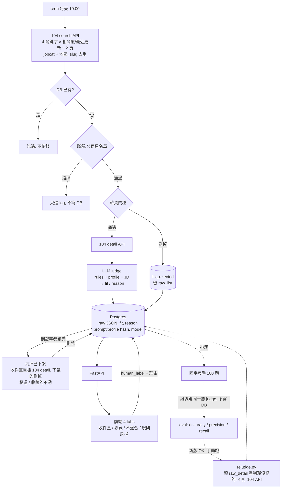

# find-jobs

個人使用的小工具：每天自動根據特定關鍵字抓 104 職缺，用 LLM 依我的 profile 判斷適不適合投，結果存進 Postgres，前端根據判斷的結果分成不同的 tab 顯示職缺

## 介面

## 流程

## Tech Stack

Python｜FastAPI + psycopg｜Postgres 18  
React + TypeScript + Tailwind｜OpenAI Responses API

跑在自己的 VPS：Docker Postgres、cron、systemd + nginx basic auth + TLS

## Eval

目前 100 筆固定職缺 ＋ 我標註的答案，存成 `dataset.jsonl` 用 git 管，每一版 prompt 都跑同一份

每次跑 `eval.py` 的結果附一行到 `history.tsv`，記下 prompt / profile / dataset 的內容 hash 和 model 名稱，分數才知道能不能互相比。
