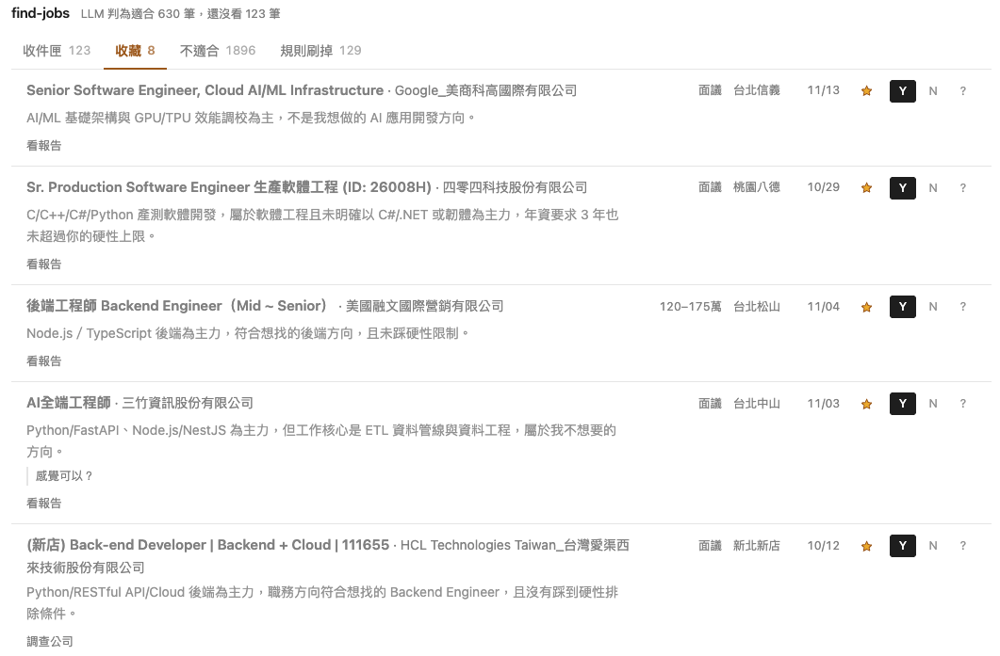
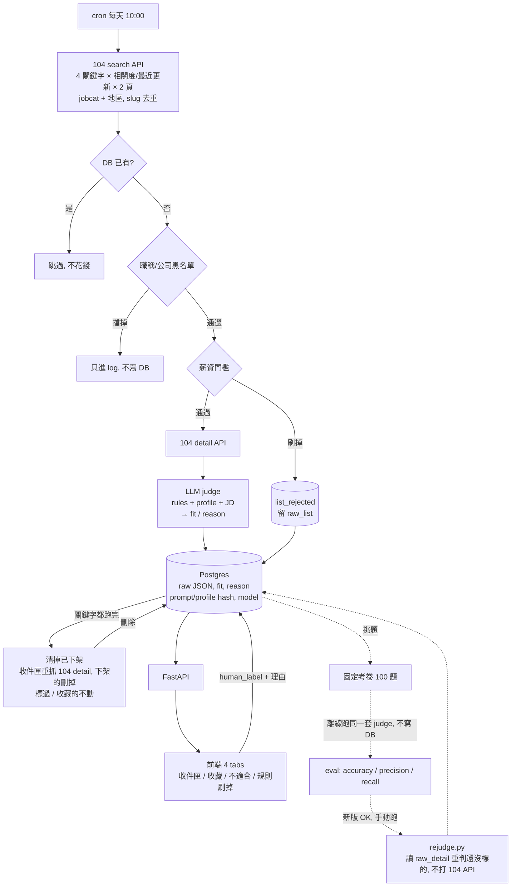
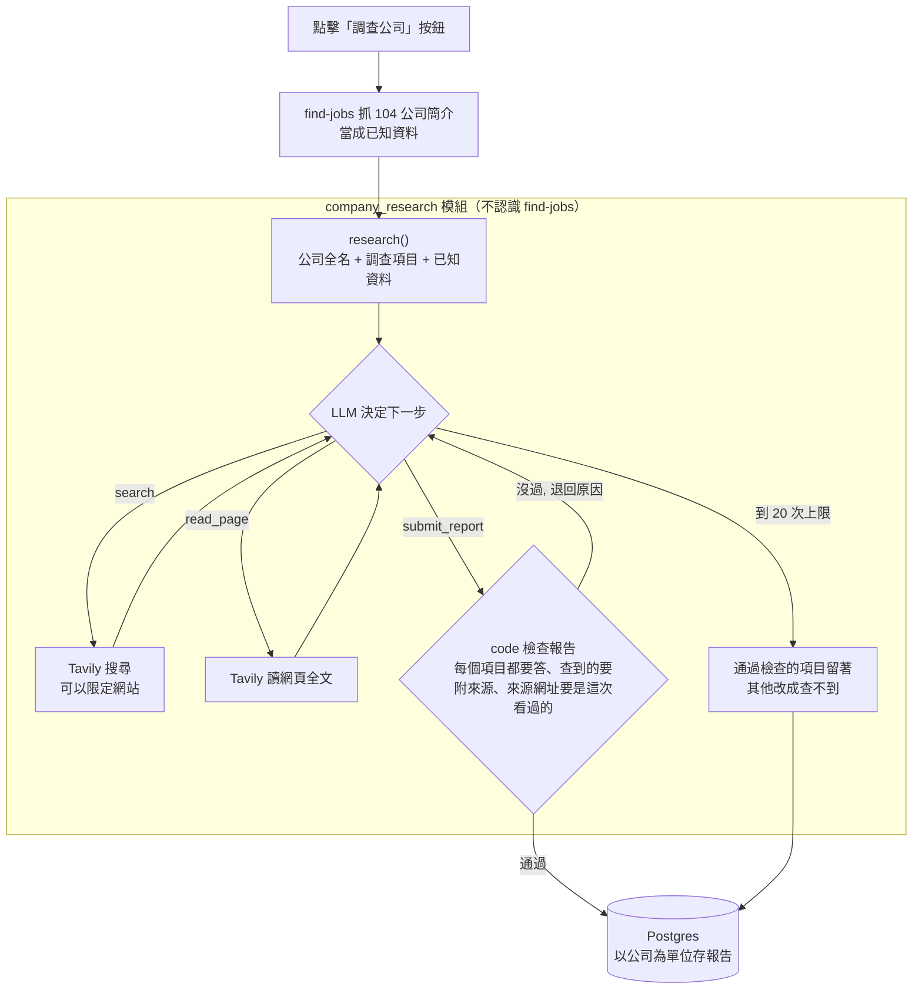

# find-jobs

個人使用的小工具：每天自動根據特定關鍵字抓 104 職缺，用 LLM 依我的 profile 判斷適不適合投，結果存進 Postgres，前端根據判斷的結果分成不同的 tab 顯示職缺。有興趣的職缺可以按一下「調查公司」按鈕，讓 agent 上網調查這家公司。

## 流程

## 職缺判斷的 Eval

目前 100 筆固定職缺 ＋ 我標註的答案，存成 `dataset.jsonl` 用 git 管，每一版 prompt 都跑同一份。

每次跑 `eval.py` 的結果附一行到 `history.tsv`，記下 prompt / profile / dataset 的內容 hash 和 model 名稱，分數才知道能不能互相比。

## 公司調查

前端每筆職缺有一顆「調查公司」按鈕。按下去之後，agent 會在背景上網查這家公司，整理成一份調查報告存進 DB。同一家公司的職缺共用同一份報告，報告底下可以重新調查。

tool-calling loop 是自己寫的，沒有用 agent 框架。

搜尋和讀網頁合計最多 15 次，用完之後只剩 `submit_report` 可以呼叫，避免模型一路查到上限都沒交報告。

### 調查項目

| 項目     | 查什麼                   | 合格標準重點                           |
| -------- | ------------------------ | -------------------------------------- |
| 在做什麼 | 賣什麼、賣給誰、怎麼賺錢 | 外行人看得懂的白話，固定三行，150 字內 |
| 近期動向 | 看得出營運狀況的消息     | 去年 1/1 以後，最多 3 則，附日期       |
| 員工評價 | PTT 上員工、面試者怎麼說 | 三年前 1/1 以後的文章，要讀全文        |

調查項目和合格標準寫在 find-jobs 這邊（`research_items.py`），起始日每次調查時才算。前端按鈕和 CLI（`research_company.py`）用同一份。

### Eval

公司資料會變，沒有固定的標準答案，所以用我的判斷當標準：

1. 挑 5 家不同類型的公司：大公司、小新創、品牌名跟公司全名不同、子公司、名稱特殊
2. 用 `research_company.py --company-url … --trace` 跑，查的跟前端按鈕一樣，整個調查過程（每次工具呼叫和回應）存成 trace
3. 每家的每個項目打 pass / fail，加一句理由
4. fail 的回去讀 trace 找原因（例如搜到範圍內的文章卻沒讀全文），改合格標準後重跑同一批

## Tech Stack

Python｜FastAPI + psycopg｜Postgres 18  
React + TypeScript + Tailwind｜OpenAI Responses API｜Tavily

跑在自己的 VPS：Docker Postgres、cron、systemd + nginx basic auth + TLS
